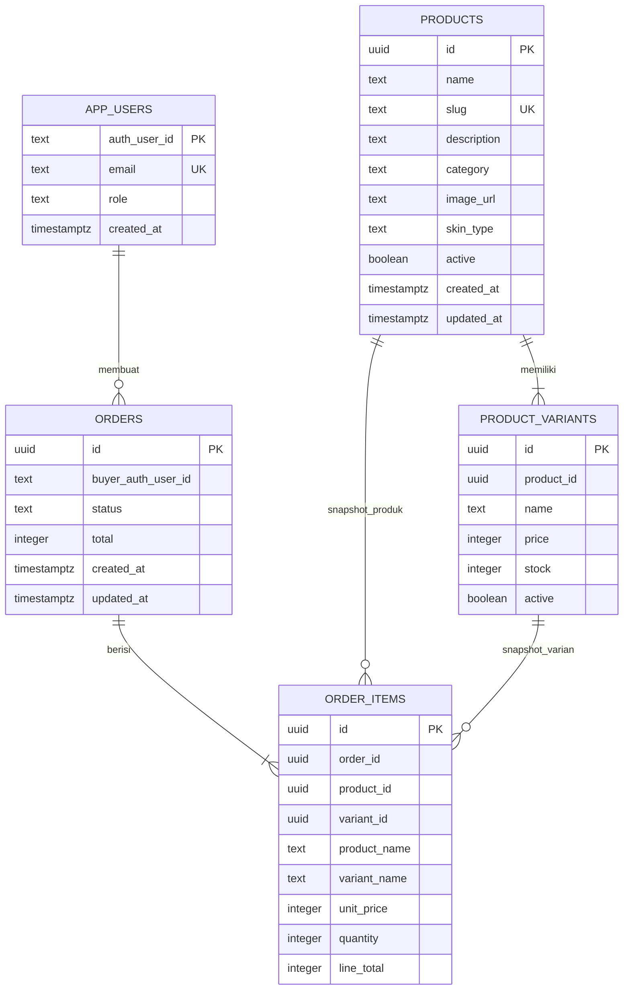

# Lumière Skin — Mini E-Commerce Skincare

Aplikasi tes teknis Fullstack Developer: katalog produk skincare, pilihan varian, keranjang, pesanan, simulasi pembayaran, dan panel inventori admin.

## Link aplikasi live

- **Aplikasi live (Production):** https://it-developer-recruitment-test.vercel.app
- **Preview v0:** https://it-developer-recruitment-test-c9423ffba8952598.v0.build

## Akun demo

Autentikasi memakai Neon Managed Auth. Buat akun pembeli melalui `/login`. Untuk akun admin, tambahkan alamat emailnya ke `ADMIN_EMAILS` di Vercel, lalu masuk menggunakan akun tersebut. Kredensial demo aktif dibagikan langsung kepada reviewer, bukan disimpan di repository publik.

## ERD

## Arsitektur dan deployment

- **Frontend:** Next.js App Router 16, React 19, Tailwind CSS 4; deploy di Vercel.
- **Backend:** Next.js Route Handlers di Vercel. Neon Managed Auth menangani email/password, endpoint aplikasi memeriksa sesi di server, dan semua perubahan admin dibatasi oleh role yang tersimpan di database serta allowlist `ADMIN_EMAILS`.
- **Katalog:** 12 produk sampel dalam grid 4 kolom desktop, dengan pencarian, filter kategori/harga/jenis kulit, pengurutan, pilihan grid/list, dan pagination 8 produk per halaman.
- **Database:** Neon PostgreSQL. Produk dan varian terpisah; harga dan stok disimpan per varian. Detail pesanan menyimpan snapshot nama dan harga saat checkout.
- **Pembayaran:** simulasi lokal tanpa payment gateway. Stok tidak dicadangkan saat checkout; stok baru berkurang dalam transaksi database saat simulasi pembayaran berhasil. Update stok menggunakan syarat `stock >= quantity`, dan pesanan dikunci saat status diubah agar pesanan bersamaan tidak oversell. Pesanan dibatalkan atau stok yang sudah habis ditolak dengan pesan yang informatif.

## Menyiapkan deployment

1. Hubungkan repository ini ke Vercel dan pastikan integrasi Neon tersedia di environment project.
2. Pastikan `DATABASE_URL` dan `NEON_AUTH_BASE_URL` tersedia di environment Development, Preview, dan Production.
3. Jalankan [`lib/db/setup.sql`](./lib/db/setup.sql) di Neon untuk membuat tabel, indeks, dan katalog demo. Jika tabel sudah ada tetapi katalog kosong, skrip ini juga akan menambahkan produk sampel; produk dengan slug yang sama tidak diduplikasi.
4. Set `ADMIN_EMAILS` ke email admin (pisahkan beberapa email dengan koma; jangan isi dengan kata sandi).
5. Deploy aplikasi, buat akun admin dan pembeli melalui `/login`, lalu catat kredensial demo yang ditujukan untuk reviewer di bagian Akun demo.
6. Verifikasi halaman katalog, pembatasan `/admin`, CRUD produk/varian, checkout, pembayaran simulasi, dan pembatalan di URL production.

## Perilaku bisnis yang diuji

- Server menghitung total harga dari harga varian terkini; nilai total dari browser tidak digunakan.
- Login mengarahkan admin langsung ke `/admin`; pembeli masuk ke katalog/pesanan dan tidak melihat tautan Admin.
- Setiap pesanan dan baris pesanan dibatasi ke user yang sedang login.
- Hanya admin yang dapat membaca panel inventori dan mengubah produk atau varian.
- Checkout membuat pesanan dengan status `pending_payment` tanpa mengurangi stok.
- Pembayaran hanya mengubah status menjadi `paid` dan mengurangi stok bila semua varian masih memiliki persediaan yang cukup; jika salah satu gagal, transaksi dibatalkan seluruhnya.
- Pembatalan hanya berlaku untuk pesanan `pending_payment` dan tidak mengurangi stok.
